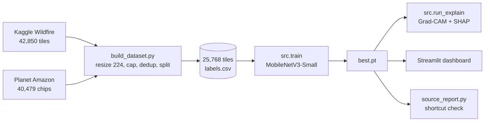
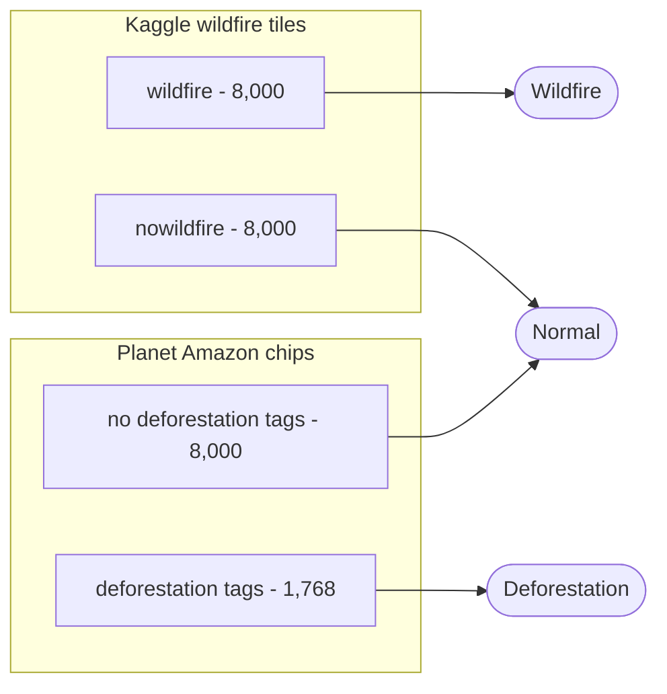
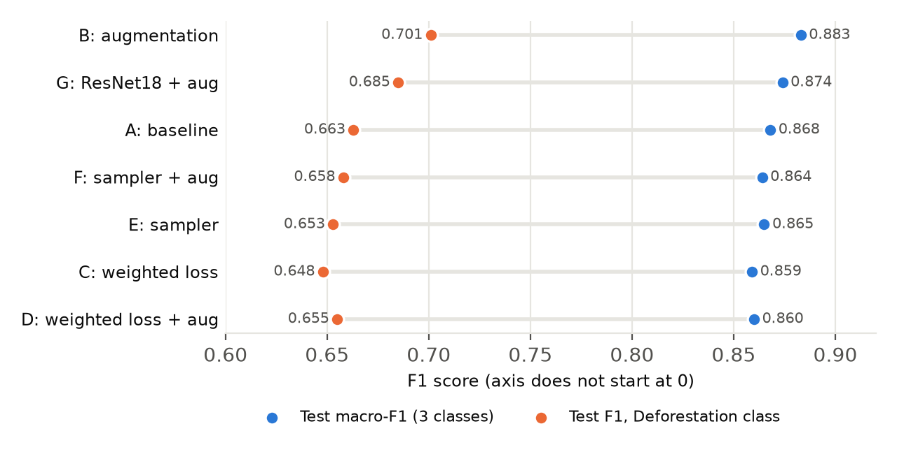
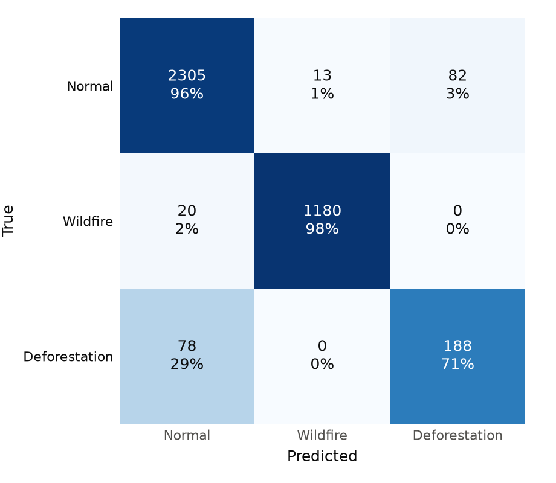
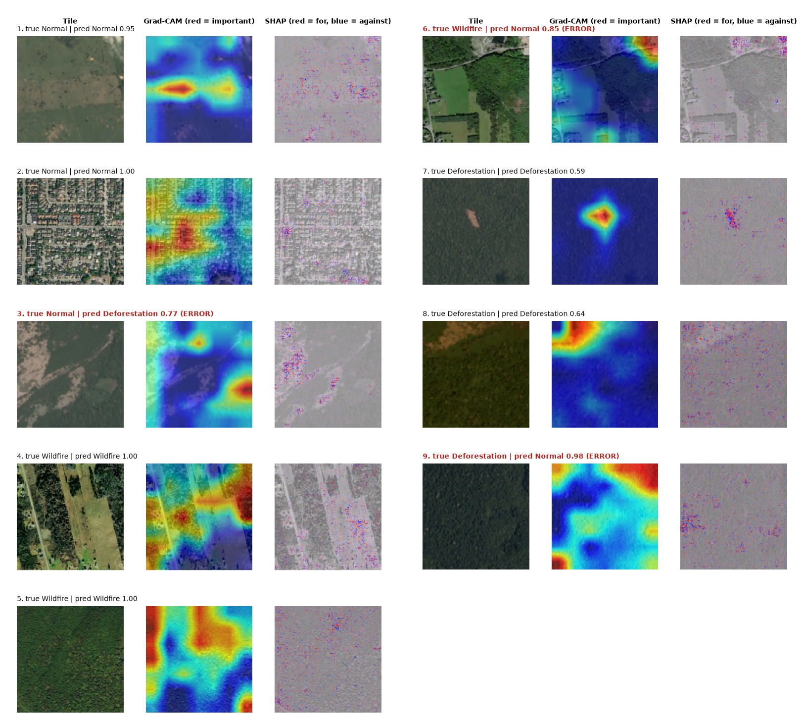
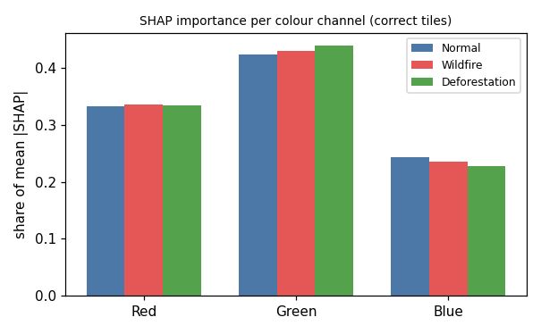

# Explainable Wildfire & Deforestation Detection (CNN + Grad-CAM + SHAP)

Programming for AI course project. A lightweight **MobileNetV3-Small** classifier labels 224x224 satellite tiles as
**Normal / Wildfire / Deforestation** and explains each decision with **Grad-CAM** and **SHAP** heatmaps, served through a
**Streamlit dashboard**.

Full write-up: [`docs/Project_Report.pdf`](docs/Project_Report.pdf) | all numbers: [`docs/RESULTS.md`](docs/RESULTS.md)

## Headline results

| | Value |
|---|---|
| Test accuracy / macro-F1 | **0.950 / 0.883** |
| F1 per class (Normal / Wildfire / Deforestation) | 0.960 / 0.986 / **0.701** |
| Honest difficulty measure (Planet-only macro-F1) | 0.817 |
| Model size | about 1.5 M parameters, runs on CPU |

### Key findings

- **Augmentation helped; class-imbalance tricks did not.** Augmentation raised macro-F1 by about +0.017 (two seeds) and Deforestation F1 by about +0.04.
  Weighted loss and a weighted sampler moved the precision/recall trade-off but did not improve F1.
- **The Kaggle wildfire task is easy for the wrong reasons.** Eight colour statistics alone score 0.92 on it (spatial shortcut in the dataset), so the Planet task (Normal vs Deforestation) is the real test.
- **Explanations work for cleared forest, not for fire or smoke.** Grad-CAM and SHAP localise visible clearings; for Wildfire they are diffuse, because the Kaggle "wildfire" tiles show burned areas, not active fire.
- **MobileNetV3-Small beat ResNet18** (0.881 vs 0.874 macro-F1) while being about 7 times smaller.

## Pipeline



## Data

Normal is drawn from **both** sources, so the data source alone cannot reveal the label inside each dataset.



| Class (source) | Train | Val | Test | Total |
|---|---|---|---|---|
| Normal (Kaggle) | 5,600 | 1,200 | 1,200 | 8,000 |
| Normal (Planet) | 5,600 | 1,200 | 1,200 | 8,000 |
| Wildfire (Kaggle) | 5,600 | 1,200 | 1,200 | 8,000 |
| Deforestation (Planet) | 1,237 | 265 | 266 | 1,768 |
| **Total** | 18,037 | 3,865 | 3,866 | 25,768 |

Deforestation = Planet tiles tagged `slash_burn`, `selective_logging`, `conventional_mine`, `artisinal_mine` or `bare_ground`
(`cloudy` tiles excluded; note Planet's `clear` tag means clear sky). Deforestation is 6.9% of the data because of a per-group cap of 8,000, not its real-world frequency.

## Results

### Imbalance and augmentation grid (MobileNetV3-Small, seed 42)

Ranked by validation macro-F1 (the selection rule); test set has 3,866 tiles.

| Run | Val macro-F1 | Test acc. | Test macro-F1 | Defo. precision | Defo. recall | Defo. F1 | Planet acc. |
|---|---|---|---|---|---|---|---|
| **B: augmentation** | 0.891 | 0.950 | **0.883** | 0.696 | 0.707 | **0.701** | 0.891 |
| G: ResNet18 + aug. | 0.880 | 0.943 | 0.874 | 0.621 | 0.763 | 0.685 | 0.872 |
| A: baseline | 0.880 | 0.943 | 0.868 | 0.640 | 0.688 | 0.663 | 0.872 |
| F: sampler + aug. | 0.878 | 0.936 | 0.864 | 0.570 | 0.778 | 0.658 | 0.853 |
| E: sampler | 0.876 | 0.946 | 0.865 | 0.700 | 0.613 | 0.653 | 0.882 |
| C: weighted loss | 0.872 | 0.937 | 0.859 | 0.612 | 0.688 | 0.648 | 0.864 |
| D: weighted loss + aug. | 0.862 | 0.928 | 0.860 | 0.529 | 0.861 | 0.655 | 0.836 |



Second seed (7), to check the augmentation gain: baseline 0.868 / 0.859 macro-F1, augmentation 0.883 / 0.879 (seed 42 / seed 7). The seed ranges do not overlap, but two seeds is a small sample.

### Final model



Every Deforestation error is a confusion with Normal (78 of 266 missed, 82 false alarms on Planet tiles).

### Does the model rely on shortcuts?

| Predictor | Accuracy | Macro-F1 | Defo. F1 | Kaggle within-source | Planet within-source |
|---|---|---|---|---|---|
| **CNN (final model)** | 0.950 | 0.883 | 0.701 | 0.986 | 0.817 |
| Colour-statistics boosting | 0.890 | 0.749 | 0.413 | 0.923 | 0.659 |
| Source-only | 0.621 | 0.429 | 0.000 | 0.333 | 0.450 |

The CNN uses real image content (+0.16 over colour statistics within Planet). The model never confuses classes across sources, so it effectively solves two binary problems and can recognise the data source.

## Explainability

Tiles were chosen by seeded random sampling (two correct tiles and one error per class), not hand-picked. Red titles are errors.



- **Deforestation (tiles 7, 8):** both methods pick out the visible clearing.
- **Wildfire (tiles 4, 5):** diffuse heatmaps; the model relies on broad context (dense remote forest vs farmland or suburbs). Smoke and fire localisation is **not** demonstrated.
- **Errors (tiles 3, 6, 9)** often look like label noise or context confusion.



Per-channel SHAP importance is nearly identical across classes, so there is no class-specific colour story.

**Faithfulness test** (mask the top 10 of 49 Grad-CAM cells vs 10 random cells, 60 correct test tiles; drop in predicted-class probability):

| Class | Grad-CAM cells | Random cells |
|---|---|---|
| All | 0.204 | 0.131 |
| Normal | 0.055 | 0.022 |
| Wildfire | 0.055 | 0.012 |
| Deforestation | **0.501** | 0.357 |

Grad-CAM is clearly faithful for Deforestation; for Normal and Wildfire the model barely reacts to masking, consistent with decisions driven by global context.

## Dashboard

```
streamlit run app/app.py
```

Upload a tile (or load a random test tile) to get an **alert banner** with an adjustable confidence threshold, class probabilities,
a **Grad-CAM** overlay for any chosen class, and an optional (slow) **SHAP** overlay. Needs `outputs\B_aug\best.pt` (download from Drive).

## Limitations

- Per-tile classification, not change detection or forecasting.
- The Wildfire class is historical burn area, not active fire or smoke; the Kaggle set has a known spatial shortcut, so its scores overstate real-world skill.
- Deforestation labels are a tag-based proxy with visible noise.
- The class balance is artificial; at real prevalence, precision would be lower and thresholds need recalibrating.
- One random split shared by all experiments, only two seeds, no confidence intervals; tiles from the same scene may appear in different splits.
- Explanations are coarse (Grad-CAM 7x7) and not validated by domain experts.

## Reproduce it (Windows cmd)

```
py -3.12 -m venv .venv
.venv\Scripts\activate.bat
python -m pip install --upgrade pip
pip install -r requirements.txt
python scripts\check_env.py
```

```
kaggle datasets download -d abdelghaniaaba/wildfire-prediction-dataset -p data\raw\wildfire --unzip
kaggle datasets download -d nikitarom/planets-dataset -p data\raw\planet --unzip
python scripts\build_dataset.py
```

```
python -m src.train --data data\processed --name B_aug --aug              # final model
python -m src.train --data data\processed --name C_wloss --imbalance weighted_loss
python scripts\summarize_runs.py --outputs outputs
python scripts\source_report.py --data data\processed --run outputs\B_aug
python -m src.run_explain --data data\processed --run outputs\B_aug
```

Training was done on a Colab T4 with `notebooks/00_colab_setup.ipynb` (data zip and results kept on Google Drive; data and checkpoints are never committed to git).
Environment: Python 3.12, PyTorch 2.14, SHAP 0.54, Streamlit 1.66 (exact versions in `requirements.lock.txt`).

## Repository layout

| Path | Purpose |
|---|---|
| `src/` | dataset, model, training, explainability code |
| `scripts/` | data build, results summary, shortcut report, environment check |
| `app/app.py` | Streamlit dashboard |
| `notebooks/00_colab_setup.ipynb` | Colab runner for the training and analysis steps |
| `docs/` | report PDF, results log, plan, figures, findings from the first attempt |

## Data sources

- Kaggle: [Wildfire Prediction Dataset (Satellite Images)](https://www.kaggle.com/datasets/abdelghaniaaba/wildfire-prediction-dataset)
- Planet: *Understanding the Amazon from Space* (Kaggle competition); mirror used: [planets-dataset](https://www.kaggle.com/datasets/nikitarom/planets-dataset)
